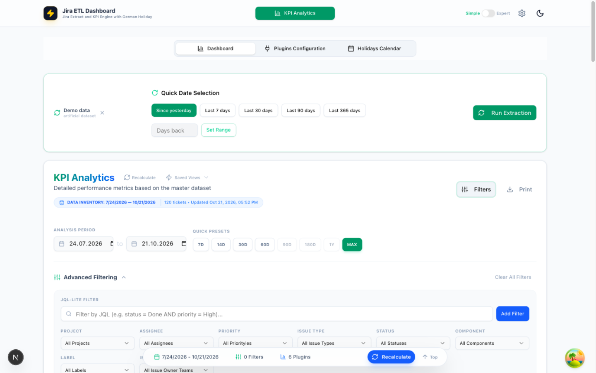
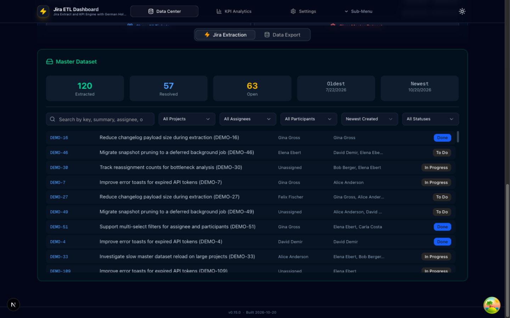
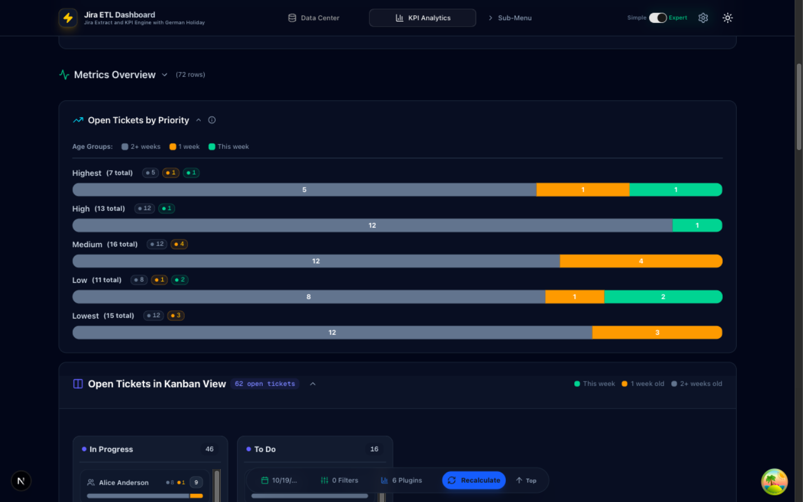
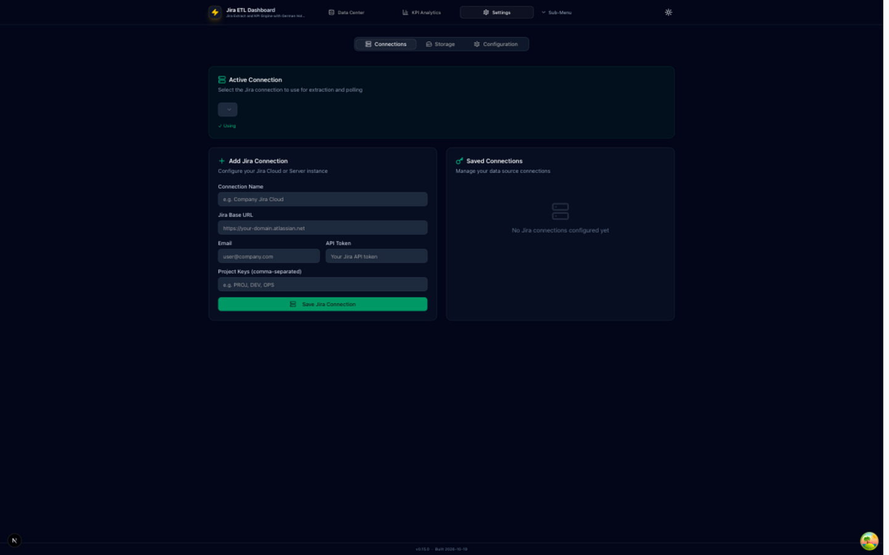
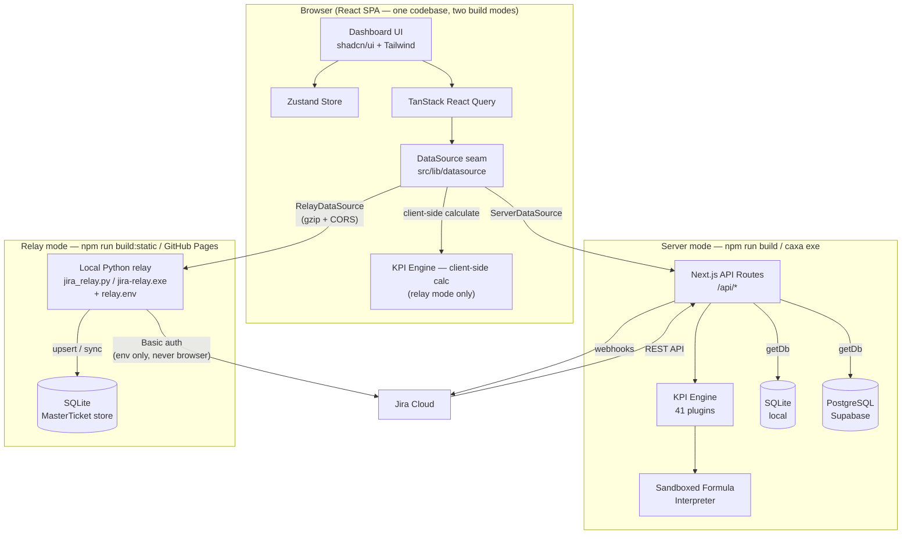
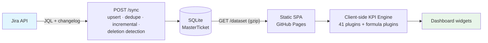
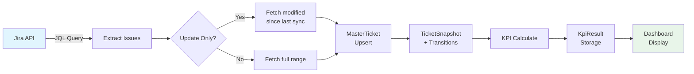
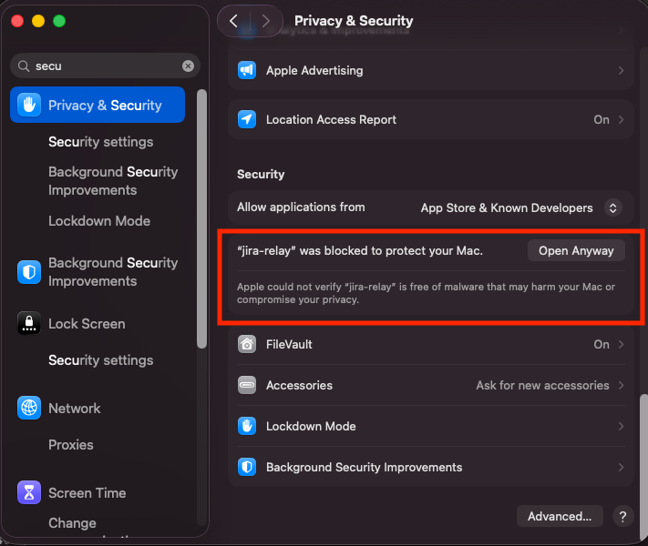

# Jira ETL Dashboard

A professional ETL dashboard that extracts ticket data from Jira Cloud or Server, calculates custom KPIs with **German holiday-aware business hour calculations**, and exports results via CSV/JSON or PostgreSQL — ready for Metabase, Supabase, or any other BI tool.

Built with **Next.js 16**, **React 19**, **Prisma ORM**, **shadcn/ui**, and **Tailwind CSS 4**.

## Contents

- [Screenshots](#-screenshots)
- [Features](#-features)
- [KPI Engine & Plugins](#-kpi-engine--plugins)
- [Technical Architecture](#️-technical-architecture)
- [Getting Started](#️-getting-started)
- [Build & Deployment](#-build--deployment)
- [Development & Testing](#-development--testing)
- [Documentation Index](#-documentation-index)
- [License](#license)

## 📸 Screenshots

### Simple Mode (default)
One combined view for everyday use: quick extraction at the top (demo data shown), the analysis period defaulting to every pulled ticket (overridable from the Analysis Period controls), and a minimal set of essential KPIs. A first-run wizard offers Jira setup or one-click demo data when nothing is configured yet.

<p align="center">
  
</p>

### Data Center (Expert)
Extract ticket data from Jira with JQL queries, date range selection, scheduled polling, and export to CSV/JSON/PostgreSQL.

<p align="center">
  
</p>

### KPI Analytics (Expert)
Interactive dashboard with 41 KPI plugins, drill-down capabilities, chart visualizations, saved views, and alert thresholds.

<p align="center">
  
</p>

### Settings
Manage Jira connections, storage engine configuration (SQLite/PostgreSQL), and application settings. Settings opens via the **gear icon** in the header (left of the dark/light toggle) — click it again to return to the previous view. Its Connections / Storage / Configuration sub-tabs are always visible in expert mode; simple mode shows the Configuration panel only.

<p align="center">
  
</p>

---

## ✨ Features

### Dashboard UX
- **Simple & Expert Mode** — Simple mode (default) is a single combined view: quick date selection and extraction at the top of the analytics dashboard, the analysis period defaulting to every pulled ticket (a manually picked period overrides it), a minimal essential plugin set, and a first-run wizard that offers Jira setup or one-click demo data when nothing is configured. Expert mode (header toggle) restores the full multi-tab experience. Settings in simple mode shows only the Configuration panel (General Settings & Rate Limiting and Webhooks collapsed by default); Connections and Storage are expert-only, and the wizard's setup action switches to Expert automatically.
- **Interactive KPI Drill-down** — Click any KPI card or chart bar to instantly view the specific Jira issues comprising that metric, in a side-out drawer with ticket summaries, assignees, and status, plus direct links back to Jira.
- **Virtual Scrolling** — Powered by `react-virtuoso` to handle large lists (1000+ tickets) in drill-downs with zero lag.
- **Saved Views / Presets** — Save named dashboard states (Dates, JQL, Filters, Layouts) to switch between different reporting contexts instantly.
- **Interactive Metrics Table** — Toggle between a grid of cards and a high-density, sortable/filterable data table for rapid metric scanning; multi-select filters for plugins, dimension types, and health states (Healthy / Warning / Critical) intersect with free-text search.
- **KPI Alert Thresholds** — Set custom Warning and Critical limits for any plugin; includes animated pulse alerts and hover tooltips.
- **Keyboard Shortcuts**:
  - `R` — Recalculate Dashboard
  - `/` — Focus JQL Search
  - `1`, `2`, `3` — Quick Tab Navigation (`1` is expert-only — Data Center is hidden in simple mode)
  - `T` — Copy the Ticket List widget as TSV
  - `Cmd/Ctrl + P` — Export to Print/PDF

### Visualization
- **Analytics Plugins** — Cumulative Flow Diagrams (CFD), Cycle Time Distribution (Histogram), Aging WIP Analysis, and First Response Time metrics.
- **Synchronized Comparison** — Distribution charts include "This Week" and "Previous Week" comparison layers with non-zero data filtering.
- **Individual Chart Export** — Download any specific visualization as a high-quality PNG image for presentations.
- **Modern Aesthetics** — Premium dark-mode interface with glassmorphism effects and smooth transitions.

### Jira ETL & Data Extraction
- **Dynamic Storage Engines** — Store your master dataset locally in SQLite for privacy or on Supabase for team-wide accessibility via Metabase.
- **Master Dataset Management** — Automatically tracks additions, updates, and deletions to maintain a faithful local mirror of Jira data.
- **Scheduled Polling** — Robust server-side background sync (1min–4hr intervals) that survives restarts and hot-reloads; the extraction list silently refreshes when a scheduled run completes.
- **Smart Extraction Logic** — `update-only` mode fetches only modified tickets since the last sync to minimize API load.
- **Live Extraction List** — Preview extracted issues with key, summary, assignee, participants, and status columns; combine free-text search with multi-select filters (project, assignee, participants, status) and sort by key or created/updated date (newest created by default).

### Architecture & Data Confidence
- **Dual Build Modes** — One codebase ships as the server product (`npm run build` → caxa exe) **and** as a static GitHub Pages app backed by a local Python relay (`npm run build:static`); a build-time mode flag plus the `DataSource` seam (`src/lib/datasource/`) selects the backend, so server-mode behavior is unchanged.
- **Demo Mode** — A **Try Demo Mode** toggle in the Data Center serves ~120 artificial tickets (full status changelogs, participants, story points) through the same `DataSource` seam — every view, filter, and KPI works without Jira credentials, and nothing is written to the database.
- **Hybrid Storage Architecture** — Dynamically switches between local SQLite and remote PostgreSQL (Supabase) at runtime based on frontend storage configuration (server mode).
- **Dual Prisma Clients** — Utilizes a specialized multi-client wrapper to support cross-engine compatibility without re-generating schemas or restarting the server.
- **TanStack React Query** — Advanced state management for automated background data synchronization, intelligent caching, and consistent loading states.
- **Scheduled Polling Resilience** — Server-side background sync persists storage configurations across sessions, ensuring data lands in the correct engine automatically (server mode).
- **Resilient Error Boundaries** — Individual widget isolation ensures that a single metric failure or calculation error never crashes the entire dashboard.
- **Smart Calculation Placement** — KPI computation runs on the server via the calculation API in server mode, and in the browser over the relay dataset in static mode — the same 41-plugin engine either way.
- **Hardened Local API Surface** — Unauthenticated endpoints accept loopback-origin requests only (CSRF protection), Jira issue keys are validated before use, and ETL runs are marked complete only after a fully successful load.
- **Security Headers** — HSTS, Content-Security-Policy, Permissions-Policy, X-Frame-Options, X-Content-Type-Options, and Referrer-Policy are set on all responses; the static build ships a relay-scoped CSP meta tag.

---

## 🔌 KPI Engine & Plugins

**41 built-in plugins** (28 core + 13 time-series) organized by business domain. Every time-based KPI **excludes weekends and German holidays** (all 16 states supported), with configurable work hours.

| Domain | Plugins | Highlights |
|--------|:-------:|------------|
| Processing Time | 7 | Avg/median processing hours, working days, cycle-time histogram, aging WIP, first response, resolution by priority |
| SLA | 4 | Compliance rate, by priority, by status (with/without clone noise) |
| Turnaround | 3 | Time in status, no-comment / no-activity follow-up flags |
| Throughput | 8 | Created/resolved/open, open by priority·status·assignee·team, Kanban view, weekly ticket list, backlog age percentiles, ticket list |
| Quality | 4 | Resolution rate, reassignments, first-time resolution, escalation rate |
| Time-Series | 13 | Weekly/daily/monthly trends: processing time, throughput, priority inflow, CFD, SLA, time-in-status, open-by-assignee |

➡️ **Full plugin reference with IDs, units, and examples: [docs/PLUGINS.md](docs/PLUGINS.md)**

### Custom Plugin Support
**Extend without Code Changes** — Create custom KPI plugins either through the dashboard's Plugin Studio (stored with your local configuration) or by dropping plugin files into the `data/custom-plugins/` directory.

- **Auto-Discovery** — File-based plugins detected and loaded on server startup
- **File Watching** — File system watcher monitors `data/custom-plugins/` for changes
- **Domain Organization** — Group custom plugins by business domain
- **Validation** — Automatic plugin structure validation before registration
- **Error Isolation** — Custom plugin failures don't affect built-in plugins
- **Sandboxed Formulas** — Custom DSL (`COUNT`/`AVG`/`SUM`/`PERCENTAGE`) and JavaScript formulas run in a sandboxed expression interpreter — no `eval`/`new Function`, with an allow-list of safe methods only (see [`custom_plugin_guide.md`](custom_plugin_guide.md))
- **UI Management** — Enable/disable plugins, create new plugins via the Plugin Studio

**Getting Started (file-based):**
1. Create a new file: `data/custom-plugins/{domain}/my-metric.ts`
2. Export a `KpiPlugin` object with `id`, `name`, `calculate` function
3. Restart the server — plugin files are loaded at startup
4. Manage via **KPI Analytics** → **Plugins Configuration** → **Custom Plugins**

### SLA Comment Rule Configuration
Choose how SLA clock resets work for SLA by Status calculations:
- **Assignee Only** (default): Only comments from the ticket's assignee reset the SLA clock
- **Anyone**: Any comment on the ticket resets the SLA clock

Configure this in **KPI Analytics** → **Plugins Configuration** → **SLA Targets by Status**.

### Workflow-Specific Formula KPIs
Site-specific metrics (rework ping-pong, clone share, rejection rate, reporter workload, top resolvers, weekly WoW snapshot, reopened tickets, open-by-project, …) are implemented as sandboxed **JavaScript/DSL formula plugins** and shipped in a local `kpi-plugin-config.json` export rather than the compiled registry, so each installation can tune them without code changes. Import the file via **Settings → Configuration Management → Import**. In relay deployments, drop the file next to the relay script/exe (`kpi-plugin-config.json`) and it is served to every visitor automatically — no manual import needed.

> **Due dates are rarely used in this workflow** — most tickets carry none. Due-date metrics (*Overdue Open Tickets*, *Due-Date Adherence*) therefore cover **only the subset of tickets that have a due date set**; interpret their percentages against that subset, not against all tickets.

---

## 🏗️ Technical Architecture

### Tech Stack
| Layer | Technology |
|-------|-----------|
| Framework | Next.js 16 (App Router), React 19, TypeScript 5 |
| State Management | **TanStack React Query 5** (Caching & Background Sync) |
| Performance | **React Virtuoso** (Virtual Scrolling) |
| Computation | Server-side KPI engine (`/api/kpi/calculate`) with query caching |
| UI | shadcn/ui, Tailwind CSS 4, Radix UI, Framer Motion |
| Database | **Prisma 6 (Dual-Client)** — SQLite (local) + PostgreSQL (Supabase) |
| Charts | Recharts 2.15 (Interactive Layers) |
| Exports | html-to-image (PNG), CSV/JSON |

### System Architecture

One React SPA, two build-time backends — the `DataSource` seam picks the implementation:



Static (relay) mode in detail:



### ETL Data Flow (server mode)



---

## 🛠️ Getting Started

### Prerequisites
- Node.js 20.9+ (Node 22 LTS recommended — used by CI)
- Jira API Token (for Cloud) or Password (for Server)

### Installation
```bash
npm install
npm run dev
```

> `npm install`, `npm run dev`, and `npm run build` automatically run the Prisma setup
> hook (`scripts/prisma-setup.mjs`), which generates the SQLite/PostgreSQL clients and
> pushes the schema to the local SQLite database.

> **No Jira account yet?** Click **Try Demo Mode** in the Data Center tab — it loads an
> artificial 90-day dataset through the regular pipeline so you can explore the extraction
> preview, filters, and the full KPI dashboard without any credentials. Exit any time; the
> demo data is never persisted.

### Environment variables
Copy `.env.example` to `.env` and adjust the values as needed:

| Variable | Purpose |
|----------|---------|
| `DATABASE_URL` | Database connection string (SQLite file path or PostgreSQL URL) |
| `JIRA_WEBHOOK_SECRET` | Shared secret used to authenticate incoming Jira webhooks |
| `CUSTOM_PLUGIN_DIR` | Directory scanned for custom KPI plugins (defaults to `data/custom-plugins/`) |
| `PORT` | Port the server listens on |
| `HOSTNAME` | Hostname/IP the server binds to |
| `PLAYWRIGHT_BASE_URL` | Override e2e test base URL (defaults to `http://localhost:3000`) |

### Database Initialization
If you are using an external PostgreSQL database (like Supabase), initialize the schema once.

**Option 1: Using a .env file (Recommended)**
1. Add `DATABASE_URL="your-postgresql-url"` to your `.env` file.
2. Run: `npm run db:push:pg`

**Option 2: Cross-platform command line**
*   **Windows (PowerShell):** `$env:DATABASE_URL="your-url"; npm run db:push:pg`
*   **Windows (cmd):** `set DATABASE_URL=your-url && npm run db:push:pg`
*   **Linux/macOS:** `DATABASE_URL="your-url" npm run db:push:pg`

---

## 🚀 Build & Deployment

### Server Build (portable exe)
```bash
# Create a portable Windows release folder with database bundled
build-exe.bat
```

### Static GitHub Pages Build (relay mode)

The app ships in two build modes from one codebase:

| | Server mode (`npm run build` / exe) | Static mode (`npm run build:static` → GitHub Pages) |
|---|---|---|
| Backend | Next.js API routes + Prisma (SQLite/PostgreSQL) | Local Python relay (`scripts/jira_relay.py`) + SQLite |
| KPI calculation | Server-side engine | **Client-side** in the browser |
| Credentials | Browser localStorage → API routes | **Only in the relay's environment** — never in the browser |
| File-based custom plugins, polling scheduler, webhook, PG export | ✅ | Hidden (feature-flagged) |
| Formula plugins (Plugin Studio), dashboard views, CSV/JSON export | ✅ | ✅ (localStorage / client-side) |

```bash
npm run build:static   # → ./out  (deploy to GitHub Pages)
python scripts/jira_relay.py   # the local data relay (stdlib only, no pip deps)
```

For users **without Python**, `build-relay-exe.bat` (Windows) /
`build-relay-exe.sh` (macOS/Linux) packages the relay into a standalone
`dist/jira-relay` executable via PyInstaller — ship it next to a `relay.env`
or `jira.env` config file (template: `scripts/relay.env.example`) and it runs anywhere.

On macOS, Gatekeeper blocks the unsigned relay on first launch — allow it via
**System Settings → Privacy & Security → Open Anyway**:

<p align="center">
  
</p>

See **[docs/STATIC_RELAY_MODE.md](docs/STATIC_RELAY_MODE.md)** for relay setup, environment variables, the standalone exe, migrating an existing `custom.db`, and the GitHub Pages workflow. To instead host the **npm server on an internal network** (team-shared), see **[docs/INTERNAL_HOSTING.md](docs/INTERNAL_HOSTING.md)** — not implemented yet; it records the required adaptation (origin allowlist, `HOSTNAME` binding, firewall scoping).

---

## 🧪 Development & Testing

```bash
npm test               # Vitest unit/integration suite
npm run test:coverage  # Coverage with enforced minimum thresholds (ratchet)
npm run e2e            # Playwright end-to-end suite (server mode, reuses a running dev server)
npm run e2e:static     # Playwright suite for the static/relay build (builds bundle + boots the Python relay)
npm run lint           # ESLint (critical rules enabled; ratchet threshold 780)
npm run type-check     # TypeScript strict check
```

Unit tests live in `__tests__/` directories next to the code they cover (shared mocks in `src/test/`); E2E specs live in `e2e/`. CI runs coverage, lint, type-check, and the Playwright E2E suite on every push to `main`/`develop`.

**E2E base URL:** Set `PLAYWRIGHT_BASE_URL` to override the default `http://localhost:3000` when running e2e tests against a different server.

---

## 📚 Documentation Index

| Document | Contents |
|----------|----------|
| [docs/PLUGINS.md](docs/PLUGINS.md) | Full KPI plugin catalog (all 41 plugins with IDs, units, examples) + plugin architecture |
| [docs/STATIC_RELAY_MODE.md](docs/STATIC_RELAY_MODE.md) | Static GitHub Pages mode: relay setup, env vars, standalone exe, migration, workflows |
| [docs/INTERNAL_HOSTING.md](docs/INTERNAL_HOSTING.md) | Planned internal-network hosting adaptation (origin allowlist, binding, firewall) |
| [docs/JIRA_FIELD_CONFIGURATION.md](docs/JIRA_FIELD_CONFIGURATION.md) | Jira custom field IDs used by the ETL (participants, issue owner team, story points) |
| [custom_plugin_guide.md](custom_plugin_guide.md) | Guide for writing custom KPI plugins (DSL + sandboxed JavaScript formulas) |
| [docs/user-manual.html](docs/user-manual.html) | End-user manual (open in a browser) |
| [docs/VERIFICATION_GUIDE.md](docs/VERIFICATION_GUIDE.md) | Historical: issue-owner-team field fix verification |
| [docs/DEBT_CLEANUP.md](docs/DEBT_CLEANUP.md) | Historical: 2026-08 code-debt cleanup records and decisions |
| [docs/REFACTORING_SUMMARY.md](docs/REFACTORING_SUMMARY.md) | Historical: refactoring phases summary |
| [CLAUDE.md](CLAUDE.md) | Development guide for AI coding agents and contributors |

---

## License
Private project. All rights reserved.
