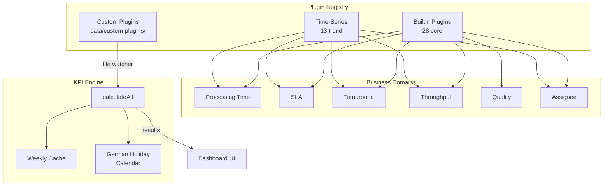

# KPI Plugin Catalog

The complete reference for all **41 built-in plugins** (28 core + 13 time-series) registered in `src/lib/kpi/plugin-loader.ts`. For creating your own plugins, see the [Custom Plugin Support](../README.md#custom-plugin-support) section in the README and [`custom_plugin_guide.md`](../custom_plugin_guide.md).

Every time-based KPI **excludes weekends and German holidays** (all 16 states supported), with configurable work hours.

## Core Plugins (28)

### Processing Time (7)

| Plugin | Unit | What it measures | Example |
|--------|:----:|------------------|---------|
| **Avg. Processing Hours** (`avg_processing_hours`) | hours | Average business hours from creation to resolution | 3 tickets taking 10h, 20h, 30h → shows **20h** |
| **Median Processing Hours** (`median_processing_hours`) | hours | Median business hours — resists outliers | `[10h, 20h, 90h]` → shows **20h** (not the 40h average) |
| **Avg. Working Days** (`avg_working_days`) | days | Average working days to resolution, skipping weekends/holidays | Created Mon, resolved next Wed → ≈ **3 working days** |
| **Cycle Time Histogram** (`cycle_time_histogram`) | tickets | Distribution of resolution times across buckets | Buckets `0–8h`, `8–24h`, `1–3d`… with counts per bucket |
| **Aging WIP Analysis** (`aging_wip`) | tickets | Open tickets bucketed by how long they've been open | Highlights stale work, e.g. `> 160h` bucket |
| **Avg. First Response Time** (`first_response_time`) | hours | Time from creation to first assignee comment/transition | First response after **4 business hours** |
| **Resolution Time by Priority** (`resolution_time_by_priority`) | hours | Avg business hours to resolution per priority | High **12h** vs Low **48h** — is urgent really faster? |

### SLA (4)

| Plugin | Unit | What it measures | Example |
|--------|:----:|------------------|---------|
| **SLA Compliance Rate** (`sla_compliance`) | % | % of tickets resolved within the configured SLA target | 40h target; 8 of 10 in time → **80%** |
| **SLA Compliance by Priority** (`sla_by_priority`) | % | Compliance rate per priority level | High **90%**, Medium **75%**, Low **60%** |
| **SLA Compliance by Status** (`sla_by_status`) | % | % of status durations meeting per-status targets (comments reset the clock) | `In Review` met its 8h target **70%** of the time |
| **SLA Compliance by Status (Excl. Clones)** (`sla_by_status_excl_clone`) | % | Same, but skips tickets with "CLONE" in the summary | Excludes clone churn for a cleaner signal |

### Turnaround (3)

| Plugin | Unit | What it measures | Example |
|--------|:----:|------------------|---------|
| **Time In Status** (`time_in_status`) | hours | Avg business hours spent in each workflow status | `In Review` averages **16h** per ticket |
| **No Comment Follow-up** (`no_comment_followup`) | tickets | Open tickets with no new comment for > 3 / > 7 working days | Flags **5** tickets silent for over a week |
| **No Activity Follow-up** (`no_activity_followup`) | tickets | Open tickets with no comment *and* no status change for > 3 / > 7 working days | Stricter variant — status changes also reset the clock |

### Throughput (8)

| Plugin | Unit | What it measures | Example |
|--------|:----:|------------------|---------|
| **Throughput** (`throughput`) | tickets | Created / Resolved / currently Open for the period | Created **40**, Resolved **35**, Open **12** |
| **Open Tickets by Priority** (`open_tickets_by_priority`) | tickets | Non-resolved tickets per priority, split by age | High **8**, of which **3** are > 2 weeks old |
| **Closed Tickets by Priority** (`closed_tickets_by_priority`) | tickets | Resolved tickets per priority, split by close time | Low **12** closed this period |
| **Open Tickets by Status** (`open_tickets_by_status`) | tickets | Non-resolved tickets per workflow status, split by age | `In Progress` **10**, `Blocked` **2** |
| **Open Tickets in Kanban View** (`open_tickets_kanban`) | tickets | Open tickets organized by Assignee / Status / Age | Kanban-style board with drill-down |
| **Weekly Ticket List** (`weekly_ticket_list`) | tickets | Opened and closed tickets, this week vs last week | This week opened **9** / closed **7** |
| **Backlog Age Percentiles** (`backlog_age_percentiles`) | days | Open-ticket age as P50 / P90 / oldest calendar days | P50 **12d**, P90 **45d**, oldest **200d** |
| **Ticket List** (`simple_ticket_list`) | tickets | Flat list of every in-scope ticket (key / summary / assignee / participants / status) with search, multi-select filters, sorting, and copy-as-TSV (press `T`) | Honors the dashboard's Advanced Filtering and analysis period |

### Quality (4)

| Plugin | Unit | What it measures | Example |
|--------|:----:|------------------|---------|
| **Resolution Rate** (`resolution_rate`) | % | % of created tickets that have been resolved | 80 of 100 resolved → **80%** |
| **Avg. Reassignments** (`reassignment_count`) | reassignments | Average number of assignee changes per ticket | Average **1.4** hand-offs per ticket |
| **First-Time Resolution Rate** (`first_time_resolution_rate`) | % | % resolved without any reassignment (first assignment stuck) | **62%** resolved on first assignment |
| **Escalation Rate** (`escalation_rate`) | % | % of tickets whose priority was raised at least once (P3 → P0) | **3.5%** escalated; 105 de-escalated tracked in details |

### Assignee (2)

| Plugin | Unit | What it measures | Example |
|--------|:----:|------------------|---------|
| **Open Tickets by Assignee** (`open_tickets_by_assignee`) | tickets | Non-resolved tickets per assignee, split by age | Alice **7**, Bob **4** (2 stale) |
| **Open Tickets by Issue Owner Team** (`open_tickets_by_issue_owner_team`) | tickets | Non-resolved tickets per owning team, split by age | Team LTIC-A **15** open |

## Time-Series / Trend Plugins (13)

Trend plugins return a point per period and render as line/area charts. Several ship in **daily, weekly, and monthly** variants.

| Plugin | Interval | Unit | What it measures | Example |
|--------|:--------:|:----:|------------------|---------|
| **Processing Time Trend** (`processing_time_trend`) | weekly | hours | Avg business hours to resolve, per week | W02 **18h**, W03 **22h** |
| **Throughput Trend** (`throughput_trend`) | weekly | tickets | Tickets resolved per week | W02 **9**, W03 **12** |
| **Priority Inflow Trend** (`priority_inflow_trend`) | weekly | tickets | New tickets per week, split P0 → P3 | W03: P1 **4**, P2 **7** |
| **Cumulative Flow Diagram** (`cumulative_flow_trend`) | daily | tickets | Tickets in each status over time (stacked CFD) | Growing `In Progress` band signals WIP buildup |
| **SLA Trend** (`sla_trend`) | weekly | % | SLA compliance rate per week | W02 **85%**, W03 **78%** |
| **SLA Compliance by Status Trend** (`sla_by_status_trend`) | weekly | % | Per-status SLA compliance per week, with per-status target reference lines | `In Review` dips below its target line |
| **SLA Compliance by Status Trend (Excl. Clones)** (`sla_by_status_excl_clone_trend`) | weekly | % | Same as above, excluding "CLONE" tickets | Cleaner trend without clone noise |
| **Time In Status Trend (Daily)** (`time_in_status_trend_daily`) | daily | hours | Avg hours per status, grouped by day | Daily `In Review` averages |
| **Time In Status Trend (Weekly)** (`time_in_status_trend_weekly`) | weekly | hours | Avg hours per status, grouped by week | Weekly `In Review` averages |
| **Time In Status Trend (Monthly)** (`time_in_status_trend_monthly`) | monthly | hours | Avg hours per status, grouped by month | Monthly `In Review` averages |
| **Open Tickets by Assignee Trend** (`open_tickets_by_assignee_trend`) | weekly | tickets | Open tickets per assignee over time | Alice's backlog trending down |
| **Open Tickets by Assignee Trend (daily)** (`open_tickets_by_assignee_trend_daily`) | daily | tickets | Same, grouped by day | Day-by-day workload shifts |
| **Open Tickets by Assignee Trend (monthly)** (`open_tickets_by_assignee_trend_monthly`) | monthly | tickets | Same, grouped by month | Month-over-month capacity |

> **Tip:** SLA-by-status trend charts draw a dashed reference line at each status's configured target, so a series dipping below its line is immediately visible.

## Plugin Architecture

**File-Based Auto-Discovery System** — Plugins are stored as independent files in domain-based directories and registered automatically at server startup; a file watcher tracks the custom-plugin directory for changes.

```
src/lib/kpi/plugins/
├── builtin/              # Core plugins (28 plugins)
│   ├── processing-time/  # 7 plugins
│   ├── sla/              # 4 plugins
│   ├── turnaround/       # 3 plugins
│   ├── throughput/       # 8 plugins
│   ├── quality/          # 4 plugins
│   └── assignee/         # 2 plugins
├── time-series/          # Trend analysis plugins (13 plugins across 9 files —
│   ├── processing-time/  #   several files export daily/weekly/monthly variants)
│   ├── sla/              # 3 plugins
│   ├── turnaround/       # 3 plugins (daily/weekly/monthly)
│   ├── throughput/       # 3 plugins
│   └── assignee/         # 3 plugins (daily/weekly/monthly)
└── custom/               # Scaffolding only — runtime custom plugins load from data/custom-plugins/
```


